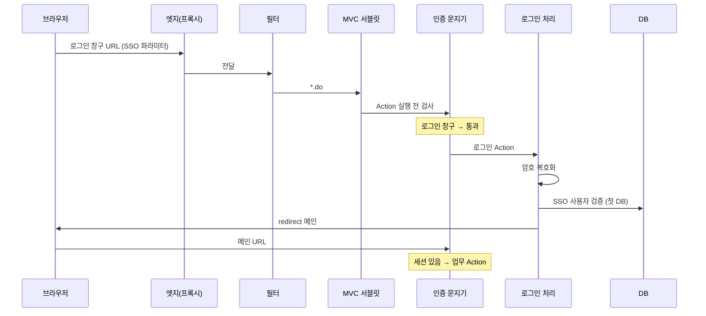

# 그룹웨어 SSO로 들어올 때 HTTP 요청이 지나가는 길

> 그룹웨어가 보낸 로그인 전용 URL 한 번이, 애플리케이션 안에서 필터·서블릿·인증 게이트·로그인 처리·세션·메인 화면까지 이어지는 순서를 개념으로 정리한다. 같은 주제를 요즘 웹에서 자주 쓰는 용어(리버스 프록시, 필터 체인, REST 등)와 짧게 맞춰 본다.

 

## 개요

디지털 아카이브 같은 사내 시스템은 브라우저가 `*.do` 형태의 주소로 요청을 보내면, WAS 위에서 **문자 인코딩 처리 → Struts 계열 MVC 진입 → “로그인했는지” 문지기 → 업무 Action** 순으로 처리하는 **구(舊)식 Java 웹 스택**에 가깝다. 그룹웨어 연동은 **일반 메뉴 URL이 아니라 “로그인 창구” URL**로 들어오며, 쿼리에 SSO 표시와 암호화된 사용자 식별값이 실려 있다. **첫 DB 조회는 “로그인 처리”가 SSO 사용자를 검증할 때**부터 시작한다(그 전 단계는 세션·메모리·설정 위주).

keyword

SSO : 다른 시스템(그룹웨어)에서 이미 알고 있는 사용자를, 아카이브 쪽에서 비밀번호 없이 한 번에 로그인시키는 방식.

WAS : Java 웹 애플리케이션이 돌아가는 애플리케이션 서버(예: Tomcat).

 

## 동작 흐름

### 그룹웨어에서 링크 클릭(대표 경로)

1. **그룹웨어**가 브라우저에게 **로그인 창구 URL**을 준다. `forwardName=sso`, 암호화된 `userId`, 암호화된 `key` 등이 붙는다.
2. **브라우저**가 `{아카이브호스트}`로 HTTP GET(또는 POST)을 보낸다.
3. **(있을 경우) 리버스 프록시·로드밸런서**가 TLS 종료, 헤더 추가(`X-Forwarded-For` 등), 업스트림으로 전달한다.
4. **문자 인코딩 필터**가 요청 전체에 대해 인코딩을 맞춘다.
5. **MVC 진입 서블릿**(`*.do` 매핑)이 요청을 받고, **기동 시 읽어 둔 URL↔Action 매핑**으로 “로그인 Action”을 고른다.
6. **인증 문지기(RequestProcessor 확장)** 가 “이미 로그인?”을 본다. 아니면 “이 경로는 로그인 창구인가?” → **로그인 창구만 통과**.
7. **로그인 Action**이 SSO면 암호를 풀어 사용자 ID를 얻고, **로그인 처리(UserEnv)** 로 SSO DB 검증 → **HttpSession + 서버 측 세션 저장**.
8. 응답은 **메인 URL로 redirect(302)**.
9. **두 번째 요청**(메인)부터는 문지기가 “로그인됨”으로 보고 메인 Action·JSP까지 진행한다.

### 이미 로그인된 채 로그인 창구를 다시 치는 경우

문지기는 **권한(authorization)** 단계까지 탈 수 있어, **로그인 Action보다 앞에서 DB 권한 조회**가 나갈 수 있다. 그룹웨어 **첫 진입(세션 없음)** 과는 갈림이 다르다.

keyword

redirect(302) : 브라우저에게 “다음은 이 URL로 다시 요청하라”고 알리는 응답. SSO 성공 후 메인으로 넘길 때 쓰인다.

Action : URL 한 덩어리(예: `/sub/login`)에 대응하는 서버 쪽 “한 번의 업무 처리” 단위(Struts 1 스타일).

 

## 개념

### 엣지·전달(요즘 HTTP에서 흔히 끼는 층)

구식 서블릿 설명만으로는 “요청이 갑자기 Tomcat에 붙는 것처럼” 보이기 쉽다. 실제로는 **TLS 종료·로드밸런싱·WAF**가 앞에 있는 경우가 많다. 프록시는 **원래 클라이언트 IP·스킴(http/https)** 을 헤더로 넘기고, WAS는 그 헤더를 보고 접속 IP를 잡기도 한다(로그인 처리에서 IP 기록 시).

keyword

TLS 종료 : HTTPS 복호화를 프록시에서 끝내고, 뒤쪽 WAS에는 HTTP로 넘기는 구성.

 

### 필터(Filter)

**서블릿보다 앞**에서 모든(또는 `/*`) 요청을 한 번씩 거친다. 여기서는 **문자셋(UTF-8 등)** 을 맞추는 역할이 대표적이다. 필터는 “로그인 여부”를 이 시스템에서 최종 판단하지 않고, **인코딩·공통 헤더** 쪽에 가깝다.

요즘 Spring Boot 등에서는 **보안 필터(Security Filter Chain)** 가 같은 자리에서 **인증·CSRF·CORS**까지 처리하는 경우가 많다. Struts 1 + 커스텀 RequestProcessor 조합은 **인증을 필터가 아니라 MVC 파이프라인 안(문지기)** 에 둔 편이다.

keyword

필터 체인 : 요청이 여러 필터를 순서대로 지나 서블릿에 도달하고, 응답은 반대 순으로 돌아오는 구조.

 

### 서블릿·MVC 디스패처(구식 `*.do` 진입)

`*.do` 요청은 **전용 Action 서블릿**이 받는다. **XML 설정은 기동 시 한 번 파싱**되어 메모리(모듈 설정)에 올라가고, **요청마다 XML 파일을 다시 읽지 않는다**. 각 요청에서 서블릿은 path(예: `/sub/login`)로 **어떤 Action·어떤 Form·어디로 forward할지**를 그 메모리 설정에서 찾는다.

**요즘과의 대응:** Spring MVC의 `DispatcherServlet`, Jakarta REST의 `@Path`+리소스 클래스, 또는 단일 SPA 뒤의 **API Gateway + 마이크로서비스**가 “한 URL → 한 처리기” 역할을 나눈다. 공통점은 **디스패처가 라우팅표를 보고 핸들러를 고른다**는 점이다.

keyword

디스패처 : HTTP 요청을 URL·메서드 등 규칙에 따라 적절한 핸들러(Action, Controller, Resource)로 넘기는 중앙 관문.

 

### 인증 문지기(로그인 전·후 갈림)

Action이 실행되기 **직전**, 커스텀 **RequestProcessor** 가 다음을 한다.

| 상태 | 동작 |
|------|------|
| 세션 없음 + **로그인 창구 URL** | Action 실행 **허용** (그룹웨어 SSO 진입로) |
| 세션 없음 + **그 외 업무 URL** | Action **생략**, 로그인 창구로 forward |
| 세션 있음 | **메뉴·카테고리별 권한** 검사(필요 시 DB) 후 Action 허용/거부 |

“로그인했는지” 판단은 **HttpSession에 저장된 세션 ID·토큰**과 **서버 메모리 SessionManager**의 토큰 일치로 이루어지며, **그룹웨어 SSO 첫 요청 전에는 DB를 보지 않는다**.

keyword

인증(authentication) : “누구인지” 확인. SSO 첫 단계의 문지기는 주로 세션 유무만 본다.

인가(authorization) : “이 메뉴를 볼 수 있는지” 확인. 로그인 후 업무 URL에서 DB와 연동될 수 있다.

 

### SSO 로그인 처리(Action 안)

공통 Action 실행 틀 안에서, **로그인 Action**만 다음을 추가로 한다.

1. `forwardName=sso` 이면 **SSO 모드**.
2. `key`를 **연동용 마스터 키**로 한 번 풀고, 그 결과로 `userId` 파라미터를 다시 풀어 **평문 사용자 ID**를 얻는다(이중 AES 구조).
3. **loginInWebApp(..., isSSO=true)** 호출 → **여기서부터 DB** (`ssoLogInBy` 계열). **비밀번호 필드는 쓰지 않는다**.
4. 성공 시 감사 로그(SSO 로그인 trace), forward 이름을 **init**으로 바꾸고 **메인 URL redirect**.

실패 시 forward를 **로그인 화면**으로 두고 에러 메시지를 attribute에 실어 JSP를 보여 준다.

keyword

연동용 마스터 키 : 그룹웨어와 아카이브가 공유하는 고정 키. URL의 `key`를 푸는 데 쓰인다(원문 값은 문서·저장소에 노출하지 않는다).

 

### 세션·쿠키(로그인 이후 요청)

성공하면 **JSESSIONID 쿠키**로 묶인 **HttpSession**에 세션 ID·토큰이 들어가고, 동시에 **서버 측 SessionManager**에 **UserSessionBean**이 올라간다. 이후 모든 `*.do`는 문지기가 같은 세션으로 “로그인됨”을 본다.

**요즘과의 차이(개념만):** SPA + **JWT/Bearer 토큰**은 쿠키 세션 대신 **Authorization 헤더**로 “누구인지”를 넘기는 패턴이 흔하다. OAuth2/OIDC는 **그룹웨어·IdP가 표준 토큰을 발급**하고, API가 토큰을 검증한다. 이 아카이브 SSO는 **전용 URL + 암호화 쿼리 + 서버 세션**이라는 **레거시 연동 형태**에 가깝다. **SameSite·Secure 쿠키**, **HTTPS 전제**는 요즘 브라우저 보안에서 공통으로 중요하다.

keyword

JSESSIONID : Java 웹에서 HttpSession을 식별하는 쿠키 이름(관례).

Bearer 토큰 : HTTP 헤더에 실어 “이 요청 주체”를 증명하는 문자열. REST API에서 흔하다.

 

### 사용자 동기화(로그인과는 별 갈림)

그룹웨어 링크 생성은 아카이브 밖에서 이루어진다. 아카이브 DB에 **동일 userId가 미리 있어야** SSO 검증이 성공한다. 사내 배치가 **그룹웨어 쪽 사용자·부서 뷰**를 읽어 CMS 사용자·그룹을 맞추는 구조가 붙어 있을 수 있다(로그인 **HTTP 한 번의 흐름**과는 별도).

 

## 구식 `*.do` 흐름 vs 요즘 HTTP 처리(한눈에)

| 층 | 이 시스템(개념) | 요즘에 자주 보는 형태 |
|----|-----------------|------------------------|
| 엣지 | (환경에 따라) 프록시·LB | CDN, API Gateway, Ingress |
| 보안·공통 | 인코딩 필터 | Security Filter Chain, CORS 미들웨어 |
| 라우팅 | Action 서블릿 + XML 매핑 | `@RestController`, Router, gRPC |
| 인증 | RequestProcessor 문지기 + 세션 | JWT, OAuth2/OIDC, Session + Redis |
| 화면 | JSP forward | SPA + JSON API |
| 연동 SSO | 암호화 쿼리 + 로그인 창구 URL | OIDC redirect, SAML, token exchange |

두 방식 모두 **“요청 → (여러 층) → 핸들러 → (선택) DB → 응답”** 골격은 같고, **어디에서 인증·라우팅·상태(세션/토큰)를 두느냐**가 다르다.

 

## 사용 방법

흐름을 다시 확인할 때는 **브라우저 개발자 도구 → Network**에서 다음을 보면 된다.

1. **첫 요청:** 로그인 창구 path, 쿼리에 SSO·암호화 파라미터, 응답 **302**와 `Location`(메인).
2. **둘째 요청:** 메인 path, 요청 헤더에 **Cookie(JSESSIONID)**.
3. **실패 시:** 로그인 화면 HTML, 에러 메시지 attribute.

서버 쪽에서는 **첫 SSO 요청에서 DB가 찍히는 시점이 loginInWebApp 이후인지**, **이미 로그인된 상태로 로그인 창구를 치면 그 전에 권한 DB가 나가는지**를 로그·SQL trace로 구분하면 된다.

keyword

Location : redirect 응답 헤더. 브라우저가 다음에 GET할 URL.

 

## 주의·제한

- SSO 파라미터 복호화 실패 시 사용자 ID가 `unknown`에 가깝게 남을 수 있고, DB 검증은 실패한다.
- **LDAP 등 외부 인증 설정이 켜져 있으면** SSO 요청도 LDAP 단계를 탈 수 있어, “DB만 본다”고 단정하기 어렵다(환경 설정에 따름).
- **연동용 마스터 키·암호화 알고리즘**은 그룹웨어와 아카이브가 맞춰야 하며, 공개 문서에 실키를 적지 않는다.
- 아카이브에 **사용자 동기화가 안 된 ID**는 SSO URL이 맞아도 로그인되지 않는다.
- 원본 코드베이스 기준 서술이며, **실제 배포 URL·키·DB 프로시저 이름**은 환경마다 다를 수 있다.
