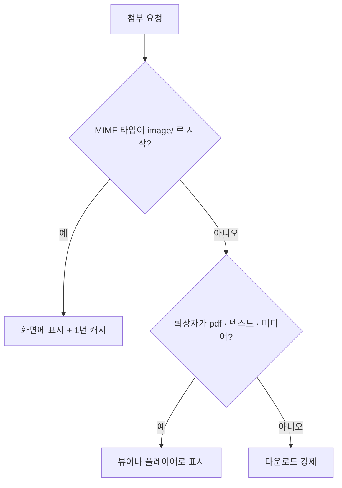

# 이관 첨부파일의 MIME 타입이 전부 octet-stream이었던 이유

> 첨부를 이관할 때 MIME 타입은 원본 파일을 확인한 결과에서 가져오게 되어 있었다. 그 결과를 만드는 단계가 없어서 모든 첨부가 "알 수 없는 파일"로 들어갔고, 앱은 이관된 사진을 사진으로 보지 못했다.

<br>

## 개요

예전 사이트의 첨부파일 약 7만 9천 건을 새 시스템 DB로 옮겼다. 행 수는 정확히 맞았고 행수 대사도 통과했다. 그런데 첨부마다 붙는 MIME 타입이 하나도 빠짐없이 `application/octet-stream`이었다. 그중 약 5만 3천 건은 jpg·png·gif 같은 사진이었다.

<div style="margin:1.35rem 0 1.75rem;padding:0.1rem 0 0.15rem 0.9rem;border-left:2px solid var(--color-strong,#1c1917);">
<p style="margin:0 0 0.45rem;font-weight:650;letter-spacing:-0.015em;color:var(--color-strong,#1c1917);">keyword</p>
<p style="margin:0.12rem 0;line-height:1.65;color:var(--color-ink,#44403c);"><span style="font-weight:650;color:var(--color-strong,#1c1917);">MIME 타입</span> : 파일 종류를 나타내는 이름표. 예를 들어 JPEG 사진은 `image/jpeg`, PDF는 `application/pdf`.</p>
<p style="margin:0.12rem 0;line-height:1.65;color:var(--color-ink,#44403c);"><span style="font-weight:650;color:var(--color-strong,#1c1917);">application/octet-stream</span> : 종류를 모르는 파일에 붙이는 이름표. 브라우저는 보통 이 파일을 다운로드한다.</p>
<p style="margin:0.12rem 0;line-height:1.65;color:var(--color-ink,#44403c);"><span style="font-weight:650;color:var(--color-strong,#1c1917);">행수 대사</span> : 원본 행 수와 적재된 행 수를 비교해서 빠진 데이터가 없는지 확인하는 검사.</p>
</div>

<br>

## 동작 흐름

1. 이관 단계는 첨부 행을 만들 때 원본 파일을 확인한 결과를 함께 조회한다. 원래 이 결과에는 실제 MIME 타입, 크기, 해시가 들어간다.
2. 하지만 원본 저장소를 돌며 그 결과를 채우는 단계가 구현되지 않았다. 확인 결과는 늘 비어 있었다.
3. 확인 결과가 없을 때 쓰는 기본값이 `application/octet-stream`이었다. 그래서 모든 첨부가 이 값으로 들어갔다.
4. 앱은 첨부를 내보낼 때 MIME 타입이 `image/`로 시작하는지 먼저 본다. 그렇지 않은 첨부는 PDF·텍스트·미디어인지 확장자로 다시 가르고, 어디에도 해당하지 않으면 다운로드로 내보낸다.
5. 사진 판정만 확장자가 아니라 MIME 타입에 기대고 있었다. 이관된 사진은 모두 마지막 갈래인 다운로드로 빠졌다.



<div style="margin:1.35rem 0 1.75rem;padding:0.1rem 0 0.15rem 0.9rem;border-left:2px solid var(--color-strong,#1c1917);">
<p style="margin:0 0 0.45rem;font-weight:650;letter-spacing:-0.015em;color:var(--color-strong,#1c1917);">keyword</p>
<p style="margin:0.12rem 0;line-height:1.65;color:var(--color-ink,#44403c);"><span style="font-weight:650;color:var(--color-strong,#1c1917);">해시</span> : 파일 내용으로 계산한 고유값. 파일이 바뀌었는지 확인할 때 쓴다.</p>
<p style="margin:0.12rem 0;line-height:1.65;color:var(--color-ink,#44403c);"><span style="font-weight:650;color:var(--color-strong,#1c1917);">기본값</span> : 다른 값이 없을 때 대신 들어가는 값.</p>
<p style="margin:0.12rem 0;line-height:1.65;color:var(--color-ink,#44403c);"><span style="font-weight:650;color:var(--color-strong,#1c1917);">캐시</span> : 한 번 받은 파일을 브라우저가 저장해 두고 다시 요청하지 않는 것.</p>
</div>

<br>

## 개념

### 행 수는 맞았는데 왜 못 잡았나

행수 대사는 몇 건이 들어갔는지만 본다. 값이 맞는지는 보지 않는다. 확인 결과가 비어 있어도 첨부 행은 빠짐없이 만들어졌다. 그래서 모든 검사가 통과했고, 문제는 값의 품질에만 남았다.

<div style="margin:1.35rem 0 1.75rem;padding:0.1rem 0 0.15rem 0.9rem;border-left:2px solid var(--color-strong,#1c1917);">
<p style="margin:0 0 0.45rem;font-weight:650;letter-spacing:-0.015em;color:var(--color-strong,#1c1917);">keyword</p>
<p style="margin:0.12rem 0;line-height:1.65;color:var(--color-ink,#44403c);"><span style="font-weight:650;color:var(--color-strong,#1c1917);">값의 품질</span> : 행은 있는데 그 안의 내용이 틀렸거나 비어 있는 상태.</p>
</div>

<br>

### 이름표가 틀리면 생기는 일

- 사진 링크를 열면 화면에 보이지 않고 다운로드된다.
- 본문 사진은 브라우저가 내용을 보고 사진이라고 추측하면 보인다. 하지만 보안 헤더가 그 추측을 막으면 사진이 깨질 수 있다.
- 사진 갈래로 가지 않아서 캐시가 걸리지 않는다. 같은 사진을 매번 다시 받는다.
- 영상은 확장자로 미디어 갈래까지는 가지만, 응답 이름표가 octet-stream이라 플레이어가 영상으로 인식하지 못할 수 있다.
- 관리 화면에서 이관된 사진을 배너로 고르면 "JPEG·PNG만 등록 가능" 검사에 걸린다. 영상·음성 아이콘도 일반 파일 아이콘으로 나온다.

<div style="margin:1.35rem 0 1.75rem;padding:0.1rem 0 0.15rem 0.9rem;border-left:2px solid var(--color-strong,#1c1917);">
<p style="margin:0 0 0.45rem;font-weight:650;letter-spacing:-0.015em;color:var(--color-strong,#1c1917);">keyword</p>
<p style="margin:0.12rem 0;line-height:1.65;color:var(--color-ink,#44403c);"><span style="font-weight:650;color:var(--color-strong,#1c1917);">보안 헤더(nosniff)</span> : 브라우저가 내용을 보고 파일 종류를 추측하지 말고, 서버가 준 이름표만 따르게 하는 응답 헤더.</p>
</div>

<br>

### 확장자로 이름표를 채운다

원본 파일을 확인하는 단계를 새로 만들지 않고, 이미 데이터에 있는 확장자로 MIME 타입을 정했다. 확인 결과가 있으면 그 값을 먼저 쓰고, 없을 때만 확장자 매핑을 쓴다. 매핑에도 없는 확장자는 기존처럼 octet-stream으로 둔다.

| 확장자 | MIME 타입 |
|---|---|
| jpg, jpeg | `image/jpeg` |
| png · gif · bmp | `image/png` · `image/gif` · `image/bmp` |
| pdf | `application/pdf` |
| hwp | `application/x-hwp` |
| mp4 · flv | `video/mp4` · `video/x-flv` |
| docx · xlsx · pptx 등 | 각 오피스 문서 형식 |

<div style="margin:1.35rem 0 1.75rem;padding:0.1rem 0 0.15rem 0.9rem;border-left:2px solid var(--color-strong,#1c1917);">
<p style="margin:0 0 0.45rem;font-weight:650;letter-spacing:-0.015em;color:var(--color-strong,#1c1917);">keyword</p>
<p style="margin:0.12rem 0;line-height:1.65;color:var(--color-ink,#44403c);"><span style="font-weight:650;color:var(--color-strong,#1c1917);">확장자 매핑</span> : 파일 이름 끝의 확장자를 보고 정해진 MIME 타입을 붙이는 대응표.</p>
</div>

<br>

### 이미 들어간 데이터와 앞으로 들어갈 데이터

수정은 두 군데에 했다. 다시 이관할 때를 위해 적재 단계가 확장자로 MIME 타입을 채우게 했다. 이미 적재된 DB에는 같은 매핑으로 한 번 UPDATE했다. 이 UPDATE는 octet-stream인 행만, 그리고 매핑이 있는 확장자만 바꾼다. 그래서 여러 번 실행해도 결과가 같다.

<div style="margin:1.35rem 0 1.75rem;padding:0.1rem 0 0.15rem 0.9rem;border-left:2px solid var(--color-strong,#1c1917);">
<p style="margin:0 0 0.45rem;font-weight:650;letter-spacing:-0.015em;color:var(--color-strong,#1c1917);">keyword</p>
<p style="margin:0.12rem 0;line-height:1.65;color:var(--color-ink,#44403c);"><span style="font-weight:650;color:var(--color-strong,#1c1917);">멱등</span> : 같은 작업을 몇 번 실행해도 결과가 한 번 실행한 것과 같은 성질.</p>
</div>

<br>

## 사용 방법

이미 적재된 DB에는 백필 SQL을 한 번 실행하고, 결과 분포를 확인한다.

```bash
psql "postgresql://{계정정보}:{비밀번호}@{내부IP}:5432/{데이터베이스명}" -v ON_ERROR_STOP=1 -f {백필SQL}
psql "postgresql://{계정정보}:{비밀번호}@{내부IP}:5432/{데이터베이스명}" \
  -c "SELECT mime_tp, count(*) FROM {첨부테이블} GROUP BY 1 ORDER BY 2 DESC"
```

적용해 보니 78,630건이 바뀌었다. `image/*`는 0건에서 52,956건이 되었다. 앱에서 사진 첨부를 요청하면 `Content-Type: image/png`와 1년 캐시 헤더가 붙어 화면에 바로 표시된다.

<div style="margin:1.35rem 0 1.75rem;padding:0.1rem 0 0.15rem 0.9rem;border-left:2px solid var(--color-strong,#1c1917);">
<p style="margin:0 0 0.45rem;font-weight:650;letter-spacing:-0.015em;color:var(--color-strong,#1c1917);">keyword</p>
<p style="margin:0.12rem 0;line-height:1.65;color:var(--color-ink,#44403c);"><span style="font-weight:650;color:var(--color-strong,#1c1917);">백필</span> : 이미 쌓인 데이터의 빈 값이나 틀린 값을 나중에 한꺼번에 채우는 작업.</p>
<p style="margin:0.12rem 0;line-height:1.65;color:var(--color-ink,#44403c);"><span style="font-weight:650;color:var(--color-strong,#1c1917);">Content-Type</span> : 서버가 응답에 실어 보내는 MIME 타입 헤더.</p>
</div>

<br>

## 주의·제한

- 471건은 여전히 octet-stream이다. hwpx·wmv·exe·분할 압축처럼 표준 이름표가 없거나 원래 다운로드가 맞는 파일이라 그대로 두었다.
- 확장자만 보고 정한 값이다. 확장자와 실제 내용이 다른 파일은 걸러내지 못한다. 원본 파일을 확인하는 단계가 생기면 그 결과가 먼저 쓰인다.
- 개발 환경에는 이관된 실제 사진 파일이 없었다. 이관 사진을 브라우저에서 직접 열어 보는 확인은 실파일이 옮겨진 환경에서 해야 한다.
